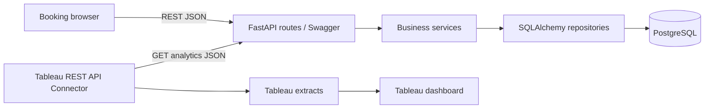

# Hotel Kong Arthur

Booking prototype and hotel/bar analytics for the E26 interdisciplinary assignment.
Python/FastAPI, SQLAlchemy, PostgreSQL 17, HTML/CSS/JavaScript og
Tableau Public (krav om fortsat dashboard afventer afklaring).

## Præsentation: v1 (MySQL + Tableau)

Den oprindelige version før tillægsopgave uge 2 er gemt i tagget
`v1-mysql-tableau`. Check tagget ud og start præsentationsversionen sådan:

```sh
git checkout v1-mysql-tableau
docker compose up --build -d
```

Denne branch kører PostgreSQL 17 via psycopg 3. Compose bruger en ny
`postgres_data` volume; den tidligere MySQL-volume bevares, men læses ikke.
Schema og anonymiserede skolefixtures genindlæses fra filer, ikke fra MySQL.
Se [migrationsstatus og verifikation](docs/postgres-migration.md).

## Run

Install Docker Desktop and start it, then run from this folder:

```sh
docker compose up --build -d
```

- Booking frontend: http://localhost:5500 (uses the real API by default)
- Swagger UI: http://localhost:8000/docs
- OpenAPI JSON: http://localhost:8000/openapi.json
- Database health: http://localhost:8000/health
- Analytics: http://localhost:8000/api/analytics/dashboard
- PostgreSQL: localhost:5433. Internt: db:5432.

Example development credentials are in `.env.example`. Copy to `.env` to override.
Ports 5500, 8000 and PostgreSQL host port 5433 are configurable.
Services bind to localhost.
`docker compose down` stops services while retaining database data in a named volume.
Migrations and seeds run once per database volume; the anonymized customer and
drinks sample is loaded into a new database automatically. Restarting does not
overwrite edited bookings.
Do not delete the volume if you need to retain data.

## Architecture



The API presentation layer is `backend/app/api`, business rules and calculations
are in `backend/app/services`, and SQL is in `backend/app/repositories`.
`frontend` is served by nginx and proxies `/api`, `/analytics`, health, Swagger and its static assets to the API service.
`db-init` waits for PostgreSQL health; the API waits for successful initialization;
nginx waits for the API health check and has its own healthcheck. Swagger runs inside the API container.

## Follow a booking request

1. The browser validates the form and POSTs `/api/bookings`.
2. FastAPI validates the JSON schema and injects a transaction-bound repository.
3. The service locks the room, validates dates/capacity and checks overlapping
   confirmed bookings. Checkout is exclusive; cancelled bookings do not block.
4. The service calculates each night's seasonal price and total. Submitted prices
   are never trusted. Repository SQL stores guest, booking and nightly snapshots.
5. The transaction commits, then the browser receives HTTP 201 and the booking.
6. Subsequent API reads query PostgreSQL. Refresh Tableau extracts to show the change.

PUT uses a complete booking payload, preserves prices for an unchanged stay and
recalculates them when dates change. DELETE returns 204 and soft-cancels the stay;
repeating it is safe. Overlap returns 409, invalid input 422, missing booking 404.
Bookings own separate guest snapshots; contact corrections cannot overwrite another
booking. Names and countries are not person identifiers. No authentication is provided in this local MVP.

## Swagger og API-test

Åbn http://localhost:8000/docs. Alle 28 operationer er samlet efter Bookings,
Inventory, Analytics, Bar og Guest feedback. Vælg en operation, Try it out og Execute.
Swagger UI serveres lokalt, inklusive JavaScript/CSS. Se
[trin-for-trin API-test](docs/api-testing.md) for konkrete booking-, bar- og review-kald.

## Tableau

[Endpoint URLs and exact JSONPath settings for the REST connector](docs/tableau-rest-endpoints.md).

Se [API-handoff til Tableau](docs/tableau-api-handoff.md) for endpoints, felter og refresh.
Tableau bruger REST API Connector direkte mod API-beregnede analyser. CSV-/Hyper-
broen er historisk og skal ikke porteres. Connectoren bruger extracts; opdatér med
Data → Refresh All Extracts. Om dashboardet fortsat er
obligatorisk, afventer C-016. Eksisterende Tableau-artefakter er ikke genvalideret
som del af denne specifikationsopgave.

## Analysevisninger i frontend

Frontendens nye analysevisninger er et krav, men er endnu ikke implementeret.
De skal hente belægning, indtjening, gæster pr. land, barsalg og
kundetilfredshed fra REST API'et; browseren må ikke beregne KPI'er eller tilgå
databasen. Se [analyse-API-vejledningen](docs/analysis-api.md) for eksisterende
paths og curl-eksempler.

## API examples

```sh
curl 'http://localhost:8000/api/rooms/availability?check_in=2026-11-20&check_out=2026-11-23&guests_count=2'
curl 'http://localhost:8000/api/bookings?page=1&page_size=100'
curl 'http://localhost:8000/api/analytics/dashboard?from=2026-01-01&to=2027-01-01'
```

The checked-in contract is `openapi/openapi.yaml`; a test compares it against
FastAPI's served schema. Existing resources use `/api`. The flat Tableau revenue exports use the requested
`/analytics/revenue/by-room-type-season` and `/analytics/revenue/by-country` URLs.

## Verification

API-/kontrakttests kører på separat
PostgreSQL-testdatabase (ingen lokal Python kræves):

```sh
docker compose --profile test run --build --rm api-tests
```

Testprofilen starter test-db → test-runner (schema/seed/checks) → api-tests.
35 tests består mod isoleret PostgreSQL, inklusive OpenAPI-lighed og samtidige
bookinger. Appens database-volume berøres ikke. Runtime-imaget indeholder ikke pytest.

Alternativt kan tests køres på værtsmaskinen med en
initialiseret PostgreSQL-testdatabase:

```sh
uv venv backend/.venv
uv pip install --python backend/.venv/bin/python -r backend/requirements-dev.txt
PYTHONPATH=backend DATABASE_URL=postgresql+psycopg://<user>:<password>@<host>:5432/<database> backend/.venv/bin/pytest -q backend/tests
node backend/tests/swagger-smoke.mjs
npm --prefix frontend run smoke:live
npm --prefix frontend test
npm --prefix frontend run smoke
docker compose --profile test run --rm test-runner
git diff --check
```

Lokale API-tests kræver en separat, initialiseret PostgreSQL-testdatabase; brug
Compose-testprofilen ovenfor som standard, ikke den importerede arbejdsdatabase. De fleste tests ruller deres transaktioner tilbage.
Concurrency-testen committer og fjerner kun sine egne testdata. Browserens
smoke-kommando bruger mock mode; PostgreSQL-adfærd verificeres separat.
Importverifikation kræver de eksterne kundefiler; se
[docs/customer-data-import.md](docs/customer-data-import.md).

## Datagrundlag og begrænsninger

Det syntetiske referenceinventar har 214 værelser, otte kategorier fra opgaven og
428 kapacitetspladser. Typefordelingen og numrene er ikke hotellets faktiske.
Referencekataloget har 20 cocktails og 10 kaffeprodukter. Eksisterende fire
barsalg og historiske bookinger er fortsat tydeligt demodata.
Historiske rækker genindlæses ved CSV/XLSX-seed i PostgreSQL; MySQL-data fra v1
migreres ikke. Importerede rækker skal mærkes `synthetic_import` og være
skrivebeskyttede. Prisfordeling og værelsesnumre påstår ikke hotellets faktiske drift.

Kundetilfredshed er implementeret med brugerens valgte 1–5-skala, gennemsnit og
svarprocent. Ingen ratings seedes. De 1.000 kundestays er synlige på
`/api/bookings` med `data_origin=synthetic_import`; datoer, værelser og gæsteantal
er syntetiske, og rækkerne er skrivebeskyttede. Drinkaggregater bruges ikke som
daterede salg eller Helene-salg.

Skoledata-loaderen bevarer de 1.000 kilderækker lokalt og forbinder dem med de
anonymiserede demo-bookinger. Opholdsdatoer placeres i 2026, og 100 ekstra
syntetiske bookinger tilføjes som særskilt mock-batch. Genkørsel er idempotent;
rå CSV/navne committes ikke. Se importvejledningen.

RevPAR findes nu i backend på `/api/analytics/revpar` og beregnes som
værelsesomsætning / disponible værelsesnætter. Det er endnu ikke besluttet, om
RevPAR er gruppens selvvalgte KPI; se C-013.

Ingen login/roller eller produktionshosting indgår i denne lokale prototype.
Tableau-status afventer C-016. Se den historiske
[API Converge-rapport](specs/converge-api-2026-10-28.md).

## Spec-driven delivery

The required artifacts are [constitution](specs/constitution.md),
[spec](specs/spec.md), [plan](specs/plan.md), and [tasks](specs/tasks.md).
`specify.md` is a compatibility pointer to `spec.md`. See
[the current Converge report](specs/converge-api-2026-10-28.md) for test evidence and gaps.


T-023: Gæster sammenkobles ikke længere efter navn/land. Nye bookinger og
kontaktændringer bruger egne snapshots. Uændret PUT genbruger samme snapshot.
Bedømte bookinger tillader kun email-/telefonrettelser; gæst/ophold kan ikke
ændres. Historisk mistede kontaktoplysninger kan ikke gendannes automatisk.


## PR-accept

Se [release-checklisten](docs/release-checklist.md) og [driftsvejledningen](docs/operations.md).
API-/Compose-accept og samlet projektaccept er forskellige vurderinger. Tableau-
dashboardets manuelle afstemning og opdateringsdemo udestår fortsat.

Testprofilen nulstiller altid hotel_kong_arthur_test på test-db før fixtures indlæses,
så tidligere importforsøg ikke påvirker testresultaterne. Appens database nulstilles
ikke. RESET_TEST_DATABASE må kun bruges med denne præcise testdatabase og host;
scriptet afviser andre kombinationer. Kør ikke flere test-runners samtidigt.
