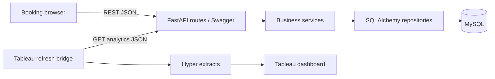

# Hotel Kong Arthur

Booking prototype and hotel/bar analytics for the E26 interdisciplinary assignment.
Python/FastAPI, SQLAlchemy, MySQL 8, HTML/CSS/JavaScript and Tableau Public.

## Run

Install Docker Desktop and start it, then run from this folder:

```sh
docker compose up --build -d
```

- Booking frontend: http://localhost:5500 (uses the real API by default)
- Swagger UI: http://localhost:8000/docs
- OpenAPI JSON: http://localhost:8000/openapi.json
- Database health: http://localhost:8000/health
- Analytics: http://localhost:8000/api/analytics/dashboard
- MySQL: localhost:3307. Container-to-container address: db:3306.

Example development credentials are in `.env.example`. Copy to `.env` to override.
Ports 5500, 8000 and 3307 are configurable. Services bind to localhost.
`docker compose down` stops services while retaining database data in a named volume.
Migrations and demo seed run once; restarting does not overwrite edited bookings.
Do not delete the volume if you need to retain data.

## Architecture



The API presentation layer is `backend/app/api`, business rules and calculations
are in `backend/app/services`, and SQL is in `backend/app/repositories`.
`frontend` is served by nginx and proxies `/api` to the API service.
`db-init` waits for MySQL health; the API waits for successful initialization;
nginx waits for the API health check. Swagger runs inside the API container.

## Follow a booking request

1. The browser validates the form and POSTs `/api/bookings`.
2. FastAPI validates the JSON schema and injects a transaction-bound repository.
3. The service locks the room, validates dates/capacity and checks overlapping
   confirmed bookings. Checkout is exclusive; cancelled bookings do not block.
4. The service calculates each night's seasonal price and total. Submitted prices
   are never trusted. Repository SQL stores guest, booking and nightly snapshots.
5. The transaction commits, then the browser receives HTTP 201 and the booking.
6. Subsequent API reads query MySQL. Refresh Tableau extracts to show the change.

PUT uses a complete booking payload, preserves prices for an unchanged stay and
recalculates them when dates change. DELETE returns 204 and soft-cancels the stay;
repeating it is safe. Overlap returns 409, invalid input 422, missing booking 404.
Shared guests follow the existing name/country identity assumption; editing contact
information updates that shared guest. No authentication is provided in this local MVP.

## Tableau

See [tableau/README.md](tableau/README.md). The native workbook and refresh bridge
consume the REST API, not a direct MySQL connection. Manual extract refresh is the
MVP meaning of live; this is not continuous push into Tableau Public.

## API examples

```sh
curl 'http://localhost:8000/api/rooms/availability?check_in=2026-11-20&check_out=2026-11-23&guests_count=2'
curl 'http://localhost:8000/api/bookings?page=1&page_size=100'
curl 'http://localhost:8000/api/analytics/dashboard?from=2026-01-01&to=2027-01-01'
```

The checked-in contract is `openapi/openapi.yaml`; a test compares it against
FastAPI's served schema. All canonical resource URLs start with `/api`.

## Verification

```sh
uv venv backend/.venv
uv pip install --python backend/.venv/bin/python -r backend/requirements.txt
PYTHONPATH=backend MYSQL_PORT=3307 backend/.venv/bin/pytest -q backend/tests
npm --prefix frontend test
npm --prefix frontend run smoke
docker compose --profile test run --rm test-runner
git diff --check
```

API tests need the initialized local MySQL instance. Most tests roll back their
transactions. The concurrency test commits and removes only its own test records.
The browser smoke command uses explicit mock mode; real MySQL behavior is tested
separately. Import verification needs the external customer files; see
[docs/customer-data-import.md](docs/customer-data-import.md).

## Scope and gaps

The seed is fictional demonstration data: 16 rooms and eight example room types,
not the real hotel's 214-room inventory or exact room categories. Analytics use
stored inventory, not a hardcoded capacity of 214. Historical customer records lack
booking dates and employee-level bar timestamps, so they cannot be treated as live
bookings or Helene's yearly sales. They remain in separate staging tables.
Customer satisfaction has no source or agreed scale and remains unimplemented;
C-009 documents that gap rather than implying full assignment compliance.

See `docs/swa-questions.md` for the ten architecture questions and
`specs/converge-2026-10-28.md` for verified behavior and remaining requirements.

## Spec-driven delivery

The required artifacts are [constitution](specs/constitution.md),
[spec](specs/spec.md), [plan](specs/plan.md), and [tasks](specs/tasks.md).
`specify.md` is a compatibility pointer to `spec.md`. See
[the dated Converge report](specs/converge-2026-10-28.md) for test evidence and gaps.
