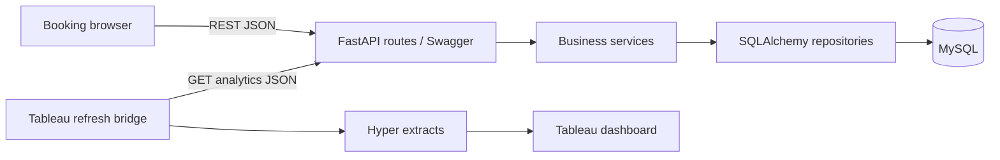

# Hotel Kong Arthur

Booking prototype and hotel/bar analytics for the E26 interdisciplinary assignment.
Python/FastAPI, SQLAlchemy, MySQL 8, HTML/CSS/JavaScript and Tableau Public.

## Run

Install Docker Desktop and start it, then run from this folder:

```sh
docker compose up --build -d
```

- Booking frontend: http://localhost:5500 (uses the real API by default)
- Swagger UI: http://localhost:8000/docs
- OpenAPI JSON: http://localhost:8000/openapi.json
- Database health: http://localhost:8000/health
- Analytics: http://localhost:8000/api/analytics/dashboard
- MySQL: localhost:3307. Container-to-container address: db:3306.

Example development credentials are in `.env.example`. Copy to `.env` to override.
Ports 5500, 8000 and 3307 are configurable. Services bind to localhost.
`docker compose down` stops services while retaining database data in a named volume.
Migrations and demo seed run once; restarting does not overwrite edited bookings.
Do not delete the volume if you need to retain data.

## Architecture



The API presentation layer is `backend/app/api`, business rules and calculations
are in `backend/app/services`, and SQL is in `backend/app/repositories`.
`frontend` is served by nginx and proxies `/api`, `/analytics`, health, Swagger and its static assets to the API service.
`db-init` waits for MySQL health; the API waits for successful initialization;
nginx waits for the API health check and has its own healthcheck. Swagger runs inside the API container.

## Follow a booking request

1. The browser validates the form and POSTs `/api/bookings`.
2. FastAPI validates the JSON schema and injects a transaction-bound repository.
3. The service locks the room, validates dates/capacity and checks overlapping
   confirmed bookings. Checkout is exclusive; cancelled bookings do not block.
4. The service calculates each night's seasonal price and total. Submitted prices
   are never trusted. Repository SQL stores guest, booking and nightly snapshots.
5. The transaction commits, then the browser receives HTTP 201 and the booking.
6. Subsequent API reads query MySQL. Refresh Tableau extracts to show the change.

PUT uses a complete booking payload, preserves prices for an unchanged stay and
recalculates them when dates change. DELETE returns 204 and soft-cancels the stay;
repeating it is safe. Overlap returns 409, invalid input 422, missing booking 404.
Bookings own separate guest snapshots; contact corrections cannot overwrite another
booking. Names and countries are not person identifiers. No authentication is provided in this local MVP.

## Swagger og API-test

Åbn http://localhost:8000/docs. Alle 27 operationer er samlet efter Bookings,
Inventory, Analytics, Bar og Guest feedback. Vælg en operation, Try it out og Execute.
Swagger UI serveres lokalt, inklusive JavaScript/CSS. Se
[trin-for-trin API-test](docs/api-testing.md) for konkrete booking-, bar- og review-kald.

## Tableau

Se [API-handoff til Tableau](docs/tableau-api-handoff.md) for endpoints, felter og refresh.
Dashboardet bygges manuelt senere efter brugerens prioritering. API'et leverer
JSON-analyser som datagrundlag. Eksisterende Tableau-artefakter fra den tidligere
iteration er ikke ændret eller genvalideret som del af API-opgaven.

## API examples

```sh
curl 'http://localhost:8000/api/rooms/availability?check_in=2026-11-20&check_out=2026-11-23&guests_count=2'
curl 'http://localhost:8000/api/bookings?page=1&page_size=100'
curl 'http://localhost:8000/api/analytics/dashboard?from=2026-01-01&to=2027-01-01'
```

The checked-in contract is `openapi/openapi.yaml`; a test compares it against
FastAPI's served schema. Existing resources use `/api`. The flat Tableau revenue exports use the requested
`/analytics/revenue/by-room-type-season` and `/analytics/revenue/by-country` URLs.

## Verification

Containeriserede API-/kontrakttests på separat testdatabase (ingen lokal Python kræves):

```sh
docker compose --profile test run --build --rm api-tests
```

Testprofilen starter test-db → test-runner (migrations/seed) → api-tests (26 tests).
Den berører ikke appens MySQL-volume. Runtime-imaget indeholder ikke pytest eller
testværktøjer; Dockerfile har et separat test-target. API-testene omfatter også
OpenAPI-validering og regressionstest af Tableau-gæsteeksportens rækker.

Alternativt på værtsmaskinen, med den lokale appdatabase kørende:

```sh
uv venv backend/.venv
uv pip install --python backend/.venv/bin/python -r backend/requirements-dev.txt
PYTHONPATH=backend MYSQL_PORT=3307 backend/.venv/bin/pytest -q backend/tests
node backend/tests/swagger-smoke.mjs
npm --prefix frontend run smoke:live
npm --prefix frontend test
npm --prefix frontend run smoke
docker compose --profile test run --rm test-runner
git diff --check
```

API tests need the initialized local MySQL instance. Most tests roll back their
transactions. The concurrency test commits and removes only its own test records.
The browser smoke command uses explicit mock mode; real MySQL behavior is tested
separately. Import verification needs the external customer files; see
[docs/customer-data-import.md](docs/customer-data-import.md).

## Datagrundlag og begrænsninger

Det syntetiske referenceinventar har 214 værelser, otte kategorier fra opgaven og
428 kapacitetspladser. Typefordelingen og numrene er ikke hotellets faktiske.
Referencekataloget har 20 cocktails og 10 kaffeprodukter. Eksisterende fire
barsalg og historiske bookinger er fortsat tydeligt demodata.

Kundetilfredshed er implementeret med brugerens valgte 1–5-skala, gennemsnit og
svarprocent. Ingen ratings seedes. Historiske kundefiler mangler datoer og
medarbejderoplysninger og bruges derfor ikke som live bookinger eller Helene-salg.

Ingen login/roller eller produktionshosting indgår i denne lokale prototype.
Tableau bygges senere manuelt. Se den aktuelle
[API Converge-rapport](specs/converge-api-2026-10-28.md).

## Spec-driven delivery

The required artifacts are [constitution](specs/constitution.md),
[spec](specs/spec.md), [plan](specs/plan.md), and [tasks](specs/tasks.md).
`specify.md` is a compatibility pointer to `spec.md`. See
[the current Converge report](specs/converge-api-2026-10-28.md) for test evidence and gaps.


T-023: Gæster sammenkobles ikke længere efter navn/land. Nye bookinger og
kontaktændringer bruger egne snapshots. Uændret PUT genbruger samme snapshot.
Bedømte bookinger tillader kun email-/telefonrettelser; gæst/ophold kan ikke
ændres. Historisk mistede kontaktoplysninger kan ikke gendannes automatisk.


## PR-accept

Se [release-checklisten](docs/release-checklist.md) og [driftsvejledningen](docs/operations.md).
API-/Compose-accept og samlet projektaccept er forskellige vurderinger. Tableau-
dashboardets manuelle afstemning og opdateringsdemo udestår fortsat.

Testprofilen nulstiller altid hotel_kong_arthur_test på test-db før fixtures indlæses,
så tidligere importforsøg ikke påvirker testresultaterne. Appens database nulstilles
ikke. RESET_TEST_DATABASE må kun bruges med denne præcise testdatabase og host;
scriptet afviser andre kombinationer. Kør ikke flere test-runners samtidigt.
