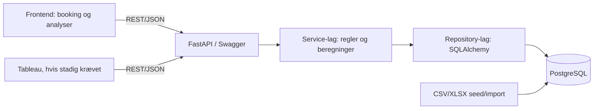

# Teknisk plan — tillægsopgave uge 2

Status: planudkast; ingen database-, API-, frontend- eller Tableau-implementering
er udført på denne branch. Databasevalget PostgreSQL er afklaret i C-012.
Specifikationen og åbne beslutninger findes i `spec.md` og `clarify.md`.

## Analyse af eksisterende MySQL-specifikke konstruktioner

Søgningen er læst som inventar til migreringsarbejdet; ingen kode eller SQL er
ændret i denne opgave.

| Fil(er) | Fund | Foreslået PostgreSQL-erstatning |
|---|---|---|
| `database/migrations/001_initial_schema.sql`, `002_booking_database_foundation.sql`, `003_customer_import_metadata.sql` | `AUTO_INCREMENT` på id-kolonner | `GENERATED ... AS IDENTITY` |
| `database/migrations/001_initial_schema.sql`, `002_booking_database_foundation.sql`, `005_booking_reviews.sql` | `TINYINT UNSIGNED` | `SMALLINT`/`INTEGER` med tilsvarende `CHECK`-grænser |
| `database/migrations/001_initial_schema.sql`, `002_booking_database_foundation.sql`, `003_customer_import_metadata.sql` | `ENUM` | `CHECK`-constraint eller PostgreSQL enum-type; valg pr. felt skal dokumenteres under implementering |
| `database/seed/001_booking_foundation_seed.sql`, `002_assignment_reference_inventory.sql`, `003_christmas_high_season.sql`; `database/import/import_customer_data.py`; `backend/app/repositories/database.py` | `ON DUPLICATE KEY UPDATE` og MySQL `VALUES(...)` | `ON CONFLICT (...) DO UPDATE SET ... EXCLUDED...`; importørens genererede SQL skal følge samme strategi |
| `database/migrations/*.sql` og `backend/app/repositories/database.py` | `DATEDIFF`, `IFNULL`, `INSERT IGNORE`, `DATE_ADD`, `GROUP_CONCAT` og backtick-quoted identifiers blev ikke fundet i den afgrænsede søgning | Ingen konkrete forekomster at omskrive; ved nyt fund brug dato-aritmetik, `COALESCE`, `ON CONFLICT DO NOTHING`, PostgreSQL dato-aritmetik, `string_agg` og dobbelte citationstegn |

## Teknologistak og lag

Python/FastAPI, SQLAlchemy, PostgreSQL via psycopg 3 og HTML/CSS/vanilla
JavaScript. Forbindelsen konfigureres via `DATABASE_URL` med driverformatet
`postgresql+psycopg://<user>:<password>@<host>:5432/<database>`; konkrete
værdier kommer fra miljøvariabler og committes ikke. API-laget ejer HTTP,
schemas og statuskoder. Services ejer bookingregler og KPI-beregninger.
Repositories ejer SQL og persistence. Databaseskiftet må ikke ændre API-kontrakten.

## Analyse-endpoints: nuværende dækning

Inventaret er kontrolleret i `backend/app/api/main.py` og
`openapi/openapi.yaml`. “Findes allerede” beskriver nuværende kode/API mod MySQL;
det er ikke bevis for PostgreSQL-kompatibilitet. API'et beholder de eksisterende
paths. Ny kontrakt for frontendens brug og eventuelle ændringer afklares i C-014.

| Endpoint | Parametre i nuværende API | Respons | Story | Status |
|---|---|---|---|---|
| `GET /api/analytics/occupancy` | `year` eller `from`/`to`; land, type, sæson | summary: solgte/disponible nætter, belægning, ADR | US-003 | Findes allerede |
| `GET /api/analytics/revenue` | samme periode- og hotel-filtre | summary med indtjening | US-004 | Findes allerede |
| `GET /api/analytics/revenue-by-room` | samme | grupper pr. fysisk værelse | US-004 | Findes allerede |
| `GET /api/analytics/revenue-by-room-type` | samme | grupper pr. værelsestype | US-004 | Findes allerede |
| `GET /api/analytics/revenue-by-country` | samme | grupper pr. bookinggæstens land | US-004 | Findes allerede |
| `GET /api/analytics/revenue-by-season` | samme | grupper pr. sæson | US-004 | Findes allerede |
| `GET /api/analytics/revenue-by-room-type-season` | samme | grupper pr. type og sæson | US-004 | Findes allerede |
| `GET /api/analytics/guests-by-country` | samme | selskaber, bookingprofiler og gæstenætter pr. land | US-004 | Findes allerede |
| `GET /api/analytics/top-performers` | samme | top værelse, type og land | US-004 | Findes allerede |
| `GET /api/analytics/bar-sales` | periode, `employee_name` | total, produkter og kategoriandele | US-005 | Findes allerede |
| `GET /api/analytics/customer-satisfaction` | periode samt hotelkohortefiltre | rating, svarprocent, kohorte og fordeling | US-006 | Findes allerede |
| `GET /api/analytics/dashboard` | samme som analysefilter | samlet analysepayload | US-003–007 | Findes allerede; Tableau-/frontendforbrug skal verificeres |
| `GET /analytics/revenue/by-room-type-season` | `year` eller `from`/`to` | flade 24 type/sæson-rækker | US-004, US-007 | Findes allerede; ældre Tableau-path uden `/api` bevares |
| `GET /analytics/revenue/by-country` | `year` eller `from`/`to` | flade land/omsætning-rækker | US-004, US-007 | Findes allerede; ældre Tableau-path uden `/api` bevares |
| Selvvalgt nøgletal, endnu ikke valgt | afventer C-013 | afventer formel og responsbeslutning | US-004, US-007, US-008 | Skal oprettes efter valg |

Der er således allerede endpoints for de navngivne analyseområder. Ingen
grundlæggende analyse-GET er identificeret som manglende i API'et; den nye
frontendvisning mangler, PostgreSQL-runtime mangler, og KPI-specifik endpoint- og
kontraktændring kan først afgøres efter Clarify-review.

## PostgreSQL-skift

- Driver og connection string: psycopg 3 og `DATABASE_URL`; konkret URL og
  afhængigheder implementeres senere.
- Compose-mål: PostgreSQL-image, intern port 5432, foreslået lokal port 5433
  (skal kontrolleres mod andre services før vedtagelse), `pg_isready`-healthcheck,
  ny named volume og bevaret db-init-flow. Én `docker compose up --build` skal
  starte applikationen. Compose-filen ændres ikke i denne specifikationsopgave.
- Schema: `AUTO_INCREMENT` → `IDENTITY`; `TINYINT(1)` → `BOOLEAN`; MySQL `ENUM`
  → `CHECK` eller PostgreSQL enum-type. Bevar præcise værdigrænser.
- Repository/import SQL: backticks → dobbelte citationstegn; `INSERT IGNORE` /
  `ON DUPLICATE KEY UPDATE` → `ON CONFLICT`; `IFNULL` → `COALESCE`;
  `DATEDIFF`/`DATE_ADD` → PostgreSQL dato-aritmetik; `GROUP_CONCAT` →
  `string_agg`. Parameterbinding bevares.
- Case: PostgreSQL sammenligner tekst case-sensitivt som standard, i modsætning
  til MySQLs almindelige collation. Landekoder normaliseres/valideres som
  uppercase ISO-koder; medarbejdernavn sammenlignes efter trimning og en
  eksplicit case-insensitiv strategi (fx `lower(...)` på begge sider). Den
  konkrete strategi skal bruges ens i API og datamigrerings-/seedflow.
- Transaktioner: `SELECT ... FOR UPDATE` for værelseslås bevares. Låsning af
  værelser i ID-rækkefølge, overlapkontrol og booking commit forbliver atomiske;
  concurrency-testen skal fortsat bestå.
- Testreset: `RESET_TEST_DATABASE` omskrives til PostgreSQL og bevarer de
  eksisterende præcise sikkerhedsspærringer for database og host.
- `.env.example` dokumenterer PostgreSQL-indstillinger og `DATABASE_URL`; ingen
  secrets lægges i Git.
- Data: re-import fra CSV/XLSX med idempotent seed/import. Ingen MySQL-rækkedata
  kopieres. `synthetic_import`-rækker skal være tydeligt markeret og skrivebeskyttede.

## API-kontrakt og frontend

API-/servicekontraktens endpoints, felter, status- og fejlkoder bevares gennem
databaseskiftet. Nye endpoints er ikke besluttet; analyse-endpointernes
parametre/fejl/warnings afventer C-014. Kontrakten skal først ændres i en senere
implementering efter godkendelse og samtidig opdatering af OpenAPI.

Frontendens aktuelle README beskriver bookingflowet. Planlagt analysevisning:

| Visning | API-kald (nyttige eksisterende paths) | Story | Status |
|---|---|---|---|
| Belægning | `/api/analytics/occupancy` | US-003, US-008 | API findes; frontendvisning mangler |
| Hotelindtjening, type/sæson/land og topresultater | `/api/analytics/revenue`, `/api/analytics/revenue-by-*`, `/api/analytics/top-performers` | US-004, US-008 | API findes; frontendvisning mangler |
| Gæster pr. land | `/api/analytics/guests-by-country` | US-004, US-008 | API findes; frontendvisning mangler |
| Barsalg | `/api/analytics/bar-sales` | US-005, US-008 | API findes; frontendvisning mangler |
| Kundetilfredshed | `/api/analytics/customer-satisfaction` | US-006, US-008 | API findes; frontendvisning mangler |
| Selvvalgt nøgletal | afventer C-013 | US-004, US-007, US-008 | Blokeret af valg og definition |

Frontend kalder kun REST API, implementerer ingen formler og har tydelige loading-,
tom- og fejltilstande. Om kald foretages automatisk ved sidevisning eller via
manuel opdatering afventer C-015.

## Tableau

Hvis Tableau fortsat er krævet (C-016), er det en ren API-forbruger. Det må ikke
læse direkte fra PostgreSQL. Eksisterende flade revenue-exports og deres ældre
paths dokumenteres; samlet workbook, filtre og refresh afstemmes mod API-tal.

## Arkitektur

## Verifikation og kommende Converge

PostgreSQL-implementationen skal verificere eksisterende API- og OpenAPI-tests,
bookingconcurrency, import-idempotens, database-resetspærrer, frontendens rigtige
API-flow, Swagger og Compose-health. Der tilføjes en kommende Converge efter
tillægsopgaven; historisk Converge fra 2026-10-28 omskrives ikke.
